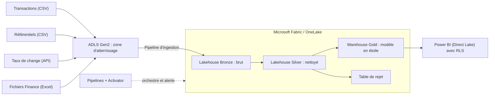

# Architecture – Banque Horizon

## Vue d'ensemble

## Couches
| Couche | Où | Contenu | Règle |
|---|---|---|---|
| Landing | ADLS Gen2 | Fichiers reçus tels quels | Jamais modifiés |
| Bronze | Lakehouse | Copie brute en Delta + colonnes techniques | Aucune transformation métier |
| Silver | Lakehouse | Données nettoyées, typées, dédoublonnées | Contrôles qualité, rejets isolés |
| Gold | Warehouse | Faits et dimensions | Prêt pour le métier |

## Environnements
| Environnement | Rôle | Branche Git |
|---|---|---|
| Dev | Développement | `dev` |
| Recette | Validation | `release` |
| Prod | Exploitation | `main` |

## Décisions d'architecture
| # | Décision | Pourquoi | Alternative écartée |
|---|---|---|---|
| D1 | Médaillon Bronze / Silver / Gold | Traçabilité, qualité progressive | Chargement direct vers un modèle final |
| D2 | Lakehouse pour Bronze et Silver | Spark, fichiers bruts, gros volumes | Tout dans le Warehouse |
| D3 | Warehouse pour Gold | T-SQL, modèle en étoile, équipes SQL/BI | Gold dans le Lakehouse |
| D4 | Delta MERGE pour l'incrémental | Évite de tout recharger, réduit le calcul | Rechargement complet |
| D5 | Direct Lake pour Power BI | Performance sans rafraîchissement lourd | Import |
| D6 | RLS au niveau du Warehouse | Sécurité au plus près des données | Filtres dans le rapport seulement |
| D7 | Table de rejet | Les erreurs sont tracées, pas perdues | Suppression silencieuse |

> À mettre à jour à chaque semaine : chaque choix doit rester justifié.

## Modèle Gold prévu
- **Fait** : `fact_transactions` (transaction_id, date_key, client_key, instrument_key, desk_key, side, quantity, price, notional, status, batch_id, loaded_at)
- **Dimensions** : `dim_client` (SCD type 2), `dim_instrument`, `dim_desk`, `dim_date`
